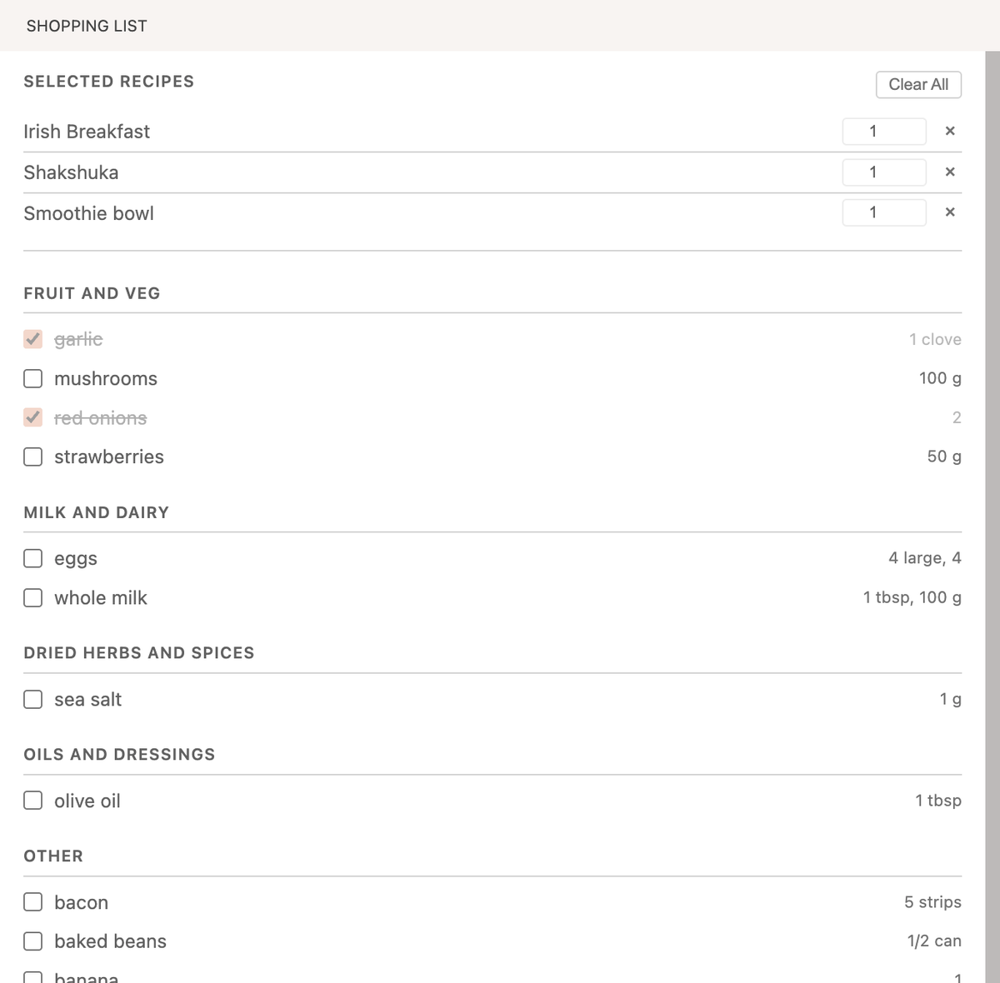

# Shopping List

Aisle-grouped shopping lists from [Cooklang](https://cooklang.org) recipes and
menus. Ships with Cook Editor; also a reference for plugins that use the
Cooklang API and outlets.

- Add a recipe or a whole `.menu` from the preview's cart button, the explorer
  context menu, or the editor title bar. Sub-recipe references are included.
- The cart is hidden on Recipe Hub previews: remote recipes are not in your
  folder, so save one to Drafts first.
- Change each entry's scale, remove entries, check items off.
- Type your own items in the box at the top (`Milk 2 l`, `Sugar 1.5kg`,
  `3 lemons`), or paste a list to add several at once. They are merged with
  the recipes' ingredients and can be edited or removed under "Other Items".
  The same lines written by CookCLI or the mobile apps show up here too.
- Items are grouped by `config/aisle.conf`; anything in `config/pantry.conf`
  is subtracted.
- The list lives in `.shopping-list` and `.shopping-checked` at the root of
  your recipe folder — the same files CookCLI uses.

User guide: https://cook.md/help/plugins/shopping-list

## For plugin authors

This plugin uses:

- the `cooklang.api.*` commands (`generateShoppingList`,
  `resolveRecipeReferences`, `parse/writeShoppingList`,
  `parse/write/compactShoppingChecked`) — see `src/cooklang-api.ts`;
- the `cooklang/recipePreview/toolbar` and `cooklang/menuPreview/toolbar`
  outlets in `package.json` → `contributes.menus`;
- a webview view (`src/shopping-list-controller.ts`, `src/webview/main.ts`).

Reference: https://cook.md/help/plugins/api and https://cook.md/help/plugins/outlets
